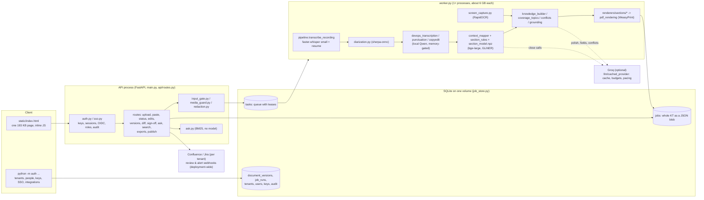

# Continuum: product readiness and technical due diligence (10 Nov 2026)

Written for: the founder, and anyone the founder asks to check this before a
pitch, a pilot or an investment (a CTO, a technical advisor, an investor's
diligence reviewer).

Code inspected: branch `Continumm` at `fc1f84d`. Read-only: the only file
added is this one. Hardware was not evaluated.

## How to read this report

Every finding says what it rests on:

- **Confirmed (code)**: read in the source at the file and line given.
- **Confirmed (run)**: seen in a run made for this report. The browser
  journey `n1` (8 Nov) was run on this commit's code and passed 19 of 19
  checks; its PDF, `evaluation/results/browser-n1/kt.pdf`, was read for
  Phase 6.
- **Measured (record)**: a figure from the evaluation record
  (`CLAUDE.md`, `docs/REPOSITORY_AUDIT.md`). It was not re-run for this
  report.
- **Recommendation** or **Assumption**: said as such.

The 3 Nov audit (`CONTINUUM_COMPLETE_AUDIT_REPORT.md`, `SECURITY_AUDIT.md`)
was a starting point only. What it said was checked again in the code.

## Status since this report

Fixed later, 10 to 12 Nov (`docs/REPOSITORY_AUDIT.md` §9abo to §9abq;
`CLAUDE.md` X131, X147 to X159):

| Finding | Status |
|---|---|
| P0-2: PDF flaws | **Fixed.** A safety rule is quoted whole in Tribal Knowledge. No "Not discussed" metadata rows. A failure said as a clause reads "Redis memory saturation, which can make ...". The job id moved to the cover's footer. Matrix case R07. |
| P0-4: repository | **README rewritten.** Merging to `main` (so CI runs) and descriptive commit messages are the founder's steps. |
| P1-2: notifications across tenants | **Fixed.** Each workspace has its own review webhook; the shared one serves a single-workspace deployment only. |
| P1-5: same input, different document | **Fixed** (the founder's decision): a sentence budget instead of a clock, and memory checked once per worker. |
| P1-6: retry | **Fixed for failures a retry can help:** a KT whose worker died keeps its input for 24 hours and offers Try again. Regenerating one section is still open. |
| P0-1, P0-3 | Preparation and messaging; no code. |
| P1-3: one tenant can starve the others | **Fixed.** Workspaces take turns in the queue: ten KTs of one hold another's back by one KT (test). Daily limits per workspace on KTs and sessions, recording minutes and LLM tokens, off until set; a submission over one gets a 429 saying when the next fits; past the tokens a KT is finished rules-only and says so. `GET /usage` and `python -m auth limits`. Request rate limits stay with the proxy (P1-1). |
| P1-4: security answers | **Fixed.** The model stack and tooling upgraded to their fixed releases: pip-audit 148 advisories in 16 packages to 2 in 1 (diskcache, no fixed release, the optional local copy-edit model's library). Every accuracy set, the noisy copies, the matrix and the gates run fresh on the new versions: the same, fact for fact (the run caught one regression, the punctuation model not loading offline, fixed first). SSO on PyJWT instead of python-jose. The API runs no media tool on uploads; workers probe them. `docs/DATA_HANDLING.md` written. Encryption at rest stays with the host. |
| P1-1, P1-7, P2, P3 | Open. |

The verdict below is as of the morning of 10 Nov. With P0-2 and the README
done, stage 3 needs P0-1 and P0-3 (demo material and how figures are
quoted) and the merge to `main`.

---

## A. Executive verdict

| Question | Answer | Evidence |
|---|---|---|
| Pitch-ready? | **Not yet. About a week of work away.** The core promise holds, but four cheap problems (P0-1 to P0-4) would cost credibility with a CTO or a diligence reviewer. | Recordings place about 80% of key facts; the PDF shows visible flaws; every accuracy figure comes from the team's own test sets; the README and Git history would not survive a technical review. |
| Demo-ready? | **Yes, as a scripted demo on prepared material.** Not as a live run on a recording nobody has seen. | Journey n1: 19/19 checks pass (sign-in to sign-out, PDF, exports, restart, receiver view, phone width). On real meetings, 158 of 194 key facts reach their section (81%). |
| Ready for a controlled pilot? | **No. About 60 days of work away.** | Every admin task needs a shell on the server. Sign-off notices go to one channel shared by all tenants. A failed KT can't be retried from the app. The same recording can give a different document. Security answers are still open. |
| Ready for paying customers? | **No.** | There are no usage limits, no metering, no self-serve onboarding and no custom templates, and the app runs on a single host. |

**The three biggest reasons it is held back:**

1. **Recorded meetings, the product's main input, are its weakest input.**
   - Written KTs it has never seen: 93.0% of facts placed without an LLM,
     96.2% with Groq.
   - Real recorded meetings: 81.4% of key facts on the ten worked on, 79.5% on
     the five held back.
   - Off-topic personal stories are printed as facts (X101, open). Technical
     terms are misheard (X108, open). Overlapping speech is not detected (X140).
2. **No accuracy figure comes from a customer's KT.**
   - Every figure is from transcripts the team wrote, public meetings or the
     founder's own mock sessions.
   - The test method is sound: held-back sets, a sealed set and fixed answer
     keys. But a buyer will ask how it does on their KTs, and today there is no
     answer.
3. **It is a well-built application, not yet a SaaS product.**
   - Tenants, roles, SSO and an audit log exist in code.
   - But onboarding a customer, adding a person, connecting SSO or Confluence
     all mean running `python -m auth ...` on the server.
   - There are no usage limits, plans or metering, no per-tenant
     notifications, no comments and no manager view.
   - The template is fixed in code: 17 sections, one renderer per section.

---

## B. Product completeness score

| Category | Score /10 | Why |
|---|---|---|
| Core KT workflow | 7 | Paste or upload, process, read, edit, version, sign off, export, add a follow-up session, Ask: all work end to end (journey 19/19). Missing: retry, regenerate one section, grouping of KTs. |
| Recording intelligence | 5 | Whisper with a fix for chunks it used to cut short (X143), diarisation, captions files, screen OCR, a punctuation model. Real meetings about 80%; anecdotes printed; terms misheard; no overlap detection. |
| AI accuracy | 6 | 93-96% on unseen written KTs, 80% on recordings; nothing measured on a customer's KT. |
| Knowledge extraction | 7 | Atomic facts, corrections, withdrawn values, hedges, disputes between speakers, a facts ledger with source, knowledge type and time. Built from rules that grow with every fix (see H). |
| Semantic mapping | 7 | A learned section model on top of embeddings, examples and rules; measured on held-back and sealed sets. |
| Document generation | 6 | Honest gaps, a source for every line, only stated connections drawn, a coverage matrix, layout checked automatically. Fixed template; filler rows; awkward gap wording; a safety rule cut short (P0-2). |
| User experience | 5 | A clean start page and per-KT tabs. No guided first run, no retry, no notifications; admin only through the command line. |
| Collaboration | 4 | Reviewer edits, versions, a diff, a three-person sign-off with gap resolution, a receiver role. No comments, assignment, mentions or per-tenant notices. |
| SaaS architecture | 4 | Tenants, roles, SSO, an audit log, a queue with leases, backups, retention. SQLite on one host, whole KTs stored as JSON blobs, a process-wide lock, no quotas or metering. |
| Security | 7 | Tenant check on every job route, hashed keys, CSRF header, hash-based CSP, upload allow-lists, secrets redacted before the LLM, prompts treat transcripts as data. Open: model-stack advisories, the cross-tenant webhook, no rate limits, ffmpeg inside the API. |
| Reliability | 7 | Every LLM call bounded in time, count and per-KT deadline, with a rules-only fallback; leased tasks retried after a crash; release gates. Single host; the document depends on free memory (P1-5). |
| Testing | 8 | 1,049 test functions; accuracy harness on six sets including a sealed one; 125-case adversarial matrix; release gates; a browser journey. CI runs only on `main` and pull requests, and `main` is 98 commits behind. |
| Product differentiation | 7 | Genuinely beyond "LLM over a transcript": nothing invented, gaps stated honestly, corrections and disputes kept, Ask answers only with the document's own sentences. Not yet proven on customer data. |

---

## 1. Architecture (Phase 1)

### 1.1 Components as built

### 1.2 The workflow, as traced in code

| Step | Where | Verdict |
|---|---|---|
| Recording in | `api/routes.py:375` `/upload`; `media_guard.py`: streamed to disk, 2 GB and 240 min caps, ffprobe container allow-list, `-protocol_whitelist file` | Solid |
| Transcription | `pipeline.py:80` (`WHISPER_MODEL`, default `small`), `pipeline.py:202` (GPU when present), `_ResumingBatchedPipeline` | Works; the small model mishears terms (X108) |
| Speakers | `diarization.py` (threshold 0.5, window step 0.5), `captions.py`, `speaker_roles.py` (giver, receiver, disputes) | Works for two or three clear voices; no overlap detection |
| Conversation analysis | `dialogue.py` (questions, answers, asides, doubt, cut-off speech), `section_rules._GREETING_ONLY_RE` | Strong on written KTs; personal stories pass through (X101) |
| Fact extraction | `context_mapper.segment_sentences`, `fact_units.split_into_facts`, `devops_transcription.resolve_self_corrections` | Strong; built from rules |
| Evidence validation | `grounding.py`, `copyedit.problems`, `ai._polish_one` guards, `knowledge/evidence.py` | Strong: LLM output that adds a number, flips a negation or drops a fragment is refused |
| Knowledge mapping | `ContextClassifier._score_sentence_candidates` + `section_model.npz` + `section_rules.SECTION_RULES` | Strong on written KTs, weaker on speech |
| Template population | `field_populator.populate_fields` (patterns, semantic, LLM gap fill) | Works; fixed 17-section schema (`kt_schema_new.json`) |
| Document | `knowledge/knowledge_builder.py`, `renderers/sections/*` (one module per section), `knowledge/document_dedup.py` | Works; template hard-coded per section |
| PDF | `pdf_rendering.py` (WeasyPrint, a fetcher that loads nothing from outside), automated overflow check | Works |
| Preview, edit, export | web page tabs; `/documents/{id}/edits`, `/versions`, `/diff`; `/export/pdf|markdown|runbook|gaps`; `/publish/confluence|jira` | Works; no DOCX export |

### 1.3 Architectural findings

| # | Module, function | Evidence | Impact | Severity | Recommendation |
|---|---|---|---|---|---|
| A1 | `job_store.py:31-41`, `docker-compose.yml` | One SQLite file on a Docker volume shared by the API and two worker replicas. Every KT is one `payload BLOB`. | Fine for a single-host pilot. Can't run on more than one host. Facts can't be queried across KTs, which blocks dashboards and a knowledge repository. | Medium (P3) | Postgres with a facts table (KT, section, fact, source, status); object storage for media and screenshots. |
| A2 | `api/routes.py`, 21 uses of `pipeline.JOB_LOCK` | Every job read in a route takes one process-wide `threading.Lock`, and the lock means nothing across processes. | Status polls from many users queue behind each other; it gives no safety with several API processes. | Low now, Medium at scale | Per-job version checks in the database instead of a global lock. |
| A3 | `api/routes.py:605-616` `/dependencies` | Loads up to 200 whole KT payloads on every request. | Gets slower with every KT a tenant adds. | Low | Compute it once per KT at build time and store it. |
| A4 | Placement and coverage logic | About 13,400 lines of rules and patterns: `context_mapper` 3,770, `knowledge_builder` 2,837, `field_populator` 2,143, `section_rules` 1,765, `devops_transcription` 1,698, `dialogue` 793, `coverage_topics` 377. The issue ledger has 146 items, most fixed by a new pattern. | Accuracy is real and protected by held-back sets, but every new speaking style needs an engineer. The risk is rules fitted to the test sets; the sealed set is the guard. A reviewer will see this as the main technical debt. | Medium | Keep the rules as guard rails. Move placement further toward the learned model (it paid most, X83) and grow its training data from customer KTs that have been corrected. |
| A5 | `copyedit.py:26-29, 60` | The local copy-edit model is skipped when free memory is under a threshold and stops after 300 s. In journey n1 it skipped one KT; on 3 Nov it skipped four. | The same input can give a different document (X131). That's a trust problem for a product that sells reliability. | Medium (P1) | Make the copy edit deterministic per deployment: always on with reserved memory, or always off. Show in the document which mode was used. |
| A6 | `static/index.html` | A single 193 KB file with inline JavaScript; about 60 `innerHTML` uses, escaped (79 escape calls) and covered by the CSP. | Works, and the CSP limits XSS. Hard for a second engineer to change safely; only the browser journey tests it. | Low now | Split into modules when the team grows; no rewrite needed for a pilot. |
| A7 | `llm_provider.py:553-791` | Groq, Gemini and a fallback chain; Gemini is not the default and isn't covered by the replay tests. | Two code paths kept for one used. | Low | Keep one provider behind the interface, or test both. |
| A8 | Repository hygiene | `README.md` describes an `app/` folder that doesn't exist and template management that was removed. `archive/` (12 files) and `pdf/` (7) are tracked. `docs/REPOSITORY_AUDIT.md` is a 590 KB development log. | A diligence reviewer reads the README first, and it is wrong. | Medium (P0, cheap) | Rewrite the README as product and architecture documentation; move the logs out of the repository root. |
| A9 | Git workflow | `.github/workflows/ci.yml` runs on pushes to `main` and on pull requests. `main` last moved on 22 Feb 2026 and is 98 commits behind `Continumm`. 37 of 115 commit messages are "fixing the issue". | Whether CI ran on recent work can't be shown (no `gh` here to check). An unreadable history looks like an uncontrolled process. | Medium (P0, cheap) | Merge to `main` through a pull request so CI runs; write real commit messages from now on. |

---

## 2. Product completeness (Phase 2)

| Area | State | Evidence |
|---|---|---|
| First-time experience | **Partial.** The start page says what the product does ("Turn a handover session into a KT document"), with upload and paste side by side and empty states. There is no guided first KT, sample KT or explanation of the document. | `static/index.html` headings; no onboarding flow |
| Creating a KT | **Implemented.** Paste, audio or video upload, or a Teams/Zoom caption file; idempotent submit (a double click makes one KT). | `routes.py:375, 451`; journey J04 |
| Organising KTs | **Partial.** List (newest first, up to 200), full-text search, delete (owner or admin), a "review due" flag. No folders, tags, systems or owners filter, and no paging past 200. | `routes.py:594-640`, `job_store.search` |
| History, revisiting | **Implemented.** KTs persist across restarts; every save is a version; versions can be compared. | `document_versions`; journey J12, J13 |
| Processing status | **Implemented.** Progress, queue position, stage. | `routes.py:830` |
| Failure recovery | **Weak.** Tasks are retried automatically after a worker crash (`job_queue.MAX_ATTEMPTS` 2). A KT that failed can't be retried from the app: the user re-uploads (up to 2 GB). | `job_queue.py:33`; no retry in the UI |
| Formats and limits | **Implemented.** Stated limits; a plain error with a request id; 413 for an oversized paste. | journey J15; `media_guard.py` |
| Editing | **Implemented.** Edit a line or a table row, move a sentence to another section; every save is a version. | journey J08, J09 |
| Regenerate one section | **Missing.** Only whole rebuilds: change the giver, rename speakers, add a session. | `routes.py:515-590` |
| Compare versions | **Implemented.** `/documents/{id}/diff`, shown on the page. | `document_diff.py` |
| Review evidence | **Implemented.** A source number on every line, a Sources list, a Transcript tab ("Where each sentence went"). No audio or video playback at the quoted moment. | PDF n1 p.3-11 |
| Unresolved information | **Implemented, a strength.** Coverage matrix, "Not Covered in This KT", follow-up list, gaps tracked through sign-off. | PDF n1 p.8-10; `signoff.py` |
| Customise templates | **Missing.** One fixed 17-section schema; the ledger records it as P1, awaiting a product decision. | `kt_schema_loader.py`; `renderers/sections/*` |
| Export | **Implemented.** PDF, Markdown, gaps CSV, runbooks, Confluence, Jira. No DOCX. | `routes.py:146-300`; journey J10, J11 |

---

## 3. SaaS capability (Phase 3)

| Capability | Status | Evidence |
|---|---|---|
| Sign-in | Implemented | API key or OIDC SSO per tenant (`sso.py`); idle sign-out |
| Self-serve registration, org creation | **Missing** | `python -m auth create-tenant` only |
| Org-level data isolation | Implemented | `auth.ensure_job_access` (`auth.py:612`) on every per-KT route; signed URLs for screenshots; tenant filter in `list` and `search` |
| Team invitations | Partial | `add-user` pre-approves an email for SSO, on the command line; no invite email or link |
| Roles, permissions | Implemented | admin, reviewer, giver, receiver (`auth.py:170-175`); journey J14 (receiver read-only, API 403) |
| User admin in the app | **Missing** | `people:manage` is defined (`auth.py:171`) and used by no route |
| Account settings, profile | Missing | `/me` reads only |
| Tenant-aware queries | Implemented | `job_store.list`, `search`, `delete_tenant` |
| Org-level configuration | Partial | Per tenant: LLM policy, SSO, vocabulary, Confluence/Jira. Per deployment only: retention (`CONTINUUM_RETENTION_DAYS`), review and alert webhooks |
| Tenant templates | Missing | Fixed schema |
| Several people on one KT | Partial | Shared within the tenant; edits are versioned with author; no locking or presence |
| Sharing | Partial | Within the tenant by role; no link sharing outside it |
| Reviewer workflow, approvals | Implemented | Three-person sign-off; gaps closed or accepted with a note; the signed version is locked (`signoff.py`) |
| Comments | **Missing** | No comment model or route |
| Usage tracking | Partial | Per-KT runs and LLM tokens (`job_runs`, `/metrics`, `scripts/ops_report.py`); no per-tenant usage view |
| Plans, limits, entitlements | **Missing** | No quota, plan or rate-limit code |
| Audit history | Partial | Recorded for sign-ins, roles, edits, deletions, sign-off (`auth.audit`); readable on the command line only |
| Account lifecycle | Partial | Disable user, delete tenant (command line) |
| Search, sort, filter | Partial | Search; newest first; no filters |
| Notifications | Weak | One deployment-wide webhook (see P1-2); no email |
| Help and support | Missing | No help page, contact or in-app guidance |
| Billing, enterprise SSO | Not needed for a pilot | SSO already exists (OIDC). Billing can wait until there's a priced plan. |

---

## 4. AI differentiation (Phase 4)

Continuum isn't an LLM wrapped around a transcript. With no LLM at all it
produces a complete, sourced document; the LLM is optional and checked. That
is the moat to defend.

| Capability | Status | Basis |
|---|---|---|
| Speaker diarisation | Production for 2-3 clear voices | Two synthetic voices told apart 7/7, one voice kept whole 25/25 (X142) |
| Overlapping speech | Not supported | X140: Whisper writes one stream; each segment gets one speaker |
| Noise | Experimental | Noisy text copies 97.4%; real meetings about 80% |
| Irrelevant talk filtered | Production for small talk and asides; **fails on anecdotes** | X98, X124, X136; X101 open |
| Term normalisation | Production for vocabulary terms; misses unknown terms | `devops_vocabulary`, per-tenant glossary; X108 open |
| Self-corrections | Production | X1-X3, X11, X22, X85; matrix cases A01-A24 |
| Conflicting statements | Production (rules), plus the LLM for meaning conflicts | X6, X8; one public/private-subnet case still needs the LLM |
| Current, historical or planned | Production | Ledger `time` field (X141); planned tools kept out of "current" (X4) |
| Assumptions, hedges | Production | `dialogue.is_hedged`, "Unconfirmed change" (X13, X27, X33) |
| Incomplete statements | Production | "[cut off]" (X138) |
| Long recordings | Production | Chunk resume (X143); 240-minute cap |
| Atomic facts | Production | `fact_units.py` |
| Evidence-backed knowledge objects | **Production, a differentiator** | Facts ledger with source, knowledge type, time, confidence; release gates check every fact is sourced |
| Section mapping | Production on text, experimental on speech | 93.0% / 96.2% unseen text; 80% recordings |
| Duplicates | Production | `document_dedup.py`, but see P0-2 |
| Relationships | Production | Diagram draws only stated connections; gates: relations 100%, wrong relations 0 |
| Procedure reconstruction | Partial | Deployment steps and chains (X61); rollback only as stated |
| Gap detection | **Production, a differentiator** | Topic-level coverage, stated gaps, "stated as not done" (X118) |
| Follow-up questions | Partial | A follow-up list of topics, not questions addressed to a person |
| Confidence | Partial | In the ledger; shown in the document only as gaps and flags |
| Prompt control | Production | Shared system prompt; transcript treated as data (X9); responses cached by prompt hash; no prompt version label |
| Structured output validation | Production | `_extract_json_response` then `ground_structured` |
| Model fallback, retry | Production | Any LLM failure falls back to rules; call, time and per-KT budgets; pacing learned from 429s (X102) |
| Evaluation | **Production, unusually strong for this stage** | Six sets with fixed keys; a sealed set read once per batch; noisy copies; 125-case matrix; release gates; replay of recorded LLM answers |
| Human review | Production | Edits, moves, sign-off; corrections are not yet fed back into the model |

**Where to win:** "a KT document you can trust for an incident at 3 a.m."
Every line sourced, nothing invented, every gap named, signed by the people
responsible. Summarisers can't promise that. The sale needs proof on
customer data and an AI receiver check (feature 3) that shows it.

---

## 5. Value to each user (Phase 5)

| User | What works | What's missing | Unneeded complexity |
|---|---|---|---|
| **Engineer giving the KT** | Turns a recorded session into a full draft with no writing. Lists what's missing per section. Lets them correct, move and sign. | Questions sent to them as a list to answer; re-running one section; telling them by email or Slack when it's their turn to sign. | Command-line-only setup by an operator; the giver must be detected or set. |
| **Engineer receiving the KT** | The Quick Reference comes first. Danger Zones, ownership and escalation, failures with fixes. "Not covered" is explicit. Ask answers with the document's own sentences. | Jumping from a line to the moment in the recording. A dashboard link and how to tell a release failed (X122). A complete rollback procedure when none was stated. | Template filler ("Documentation link: Not discussed") the reader has to skip. |
| **Engineering manager** | Coverage matrix and an "At a glance" per KT; sign-off state; search; shared components across KTs. | One view of every KT with its readiness, open gaps and sign-off; comparing KTs; team-wide risk. The data is there per KT; nothing brings it together. | None; this user is simply not served yet. |

---

## 6. Document quality (Phase 6)

Read from the PDF produced by the current code in journey n1 (QuickBite, 12
pages, without an LLM).

**What is enterprise-grade:**
- Cover "At a glance": 2 sections covered well, 8 partly, 4 not covered, 16
  to confirm.
- States "Generated without an LLM".
- Quick Reference first.
- A source number on every line.
- The diagram draws only connections the KT stated, and a table quotes the
  sentence for each one.
- "Not Covered in This KT" is a section of its own.
- The coverage matrix is explicit ("2 of 5 topics covered; stated as not
  documented: RTO, RPO").
- 30 of 30 facts are accounted for.

**What a CTO would notice within a minute (all confirmed in the PDF and the code):**

1. **A safety rule shortened until it says something else.**
   - The Tribal Knowledge table prints "Never delete messages from production
     queues during an…": the condition "without approval" is cut (p.9).
   - The cause: `document_dedup.excerpt` (`knowledge/document_dedup.py:142-150`)
     turns any repeated statement into an eight-word pointer, safety rules
     included.
   - This conflicts with invariant 3 ("Safety rules stay word for word").
2. **Template filler.**
   - "Architecture Metadata: Documentation link: Not discussed / Last updated:
     Not discussed / Verified by incoming owner: Not discussed" (p.6).
   - The same template topics then fill the follow-up list (p.10).
3. **Machine-made sentences.**
   - "Not covered in the KT session: a fix for Redis memory saturation can also
     make courier locations appear stale" (p.7).
   - "no fix stated for: Redis memory saturation can also make courier
     locations appear stale" (p.10): a whole sentence pasted into a template
     slot.
4. **An internal id on the cover** ("JOB ID 3DC56223").

**Dynamic or hard-coded?** Hard-coded.
- The schema (`kt_schema_new.json`, 17 sections), one renderer module per
  section (`renderers/sections/*.py`), the polish prompts and the routing rules
  all name section ids.
- A customer's own KT format means code changes in four places.
- The underlying model (facts with section, topic and source) is
  template-agnostic. A template layer that maps customer headings to the
  internal sections is possible without rewriting the pipeline (P2-1).

---

## 7. Engineering quality and security (Phase 7)

**Engineering.** Unusually disciplined for this stage:
- every invariant has code and a test;
- LLM calls are bounded;
- tasks are leased and retried after a crash;
- backups are verified, migrations run on start-up, health and readiness
  endpoints exist, and Prometheus metrics come with a Grafana dashboard and
  alerts (`deploy/`);
- dependencies are pinned in a lock file that CI checks.

The weaknesses are A1-A9 above.

**Security, in place (confirmed in code):**
- Keys stored as SHA-256 hashes.
- HttpOnly SameSite cookies, plus a CSRF header required on cookie writes
  (`auth.py:579`).
- A hash-based CSP (`browser_security.py:34`).
- A tenant check on every per-KT route.
- Uploads streamed, capped and limited to an allow-list of containers, with
  ffmpeg restricted to local files.
- Paste and request size limits.
- Credentials redacted before the LLM, the cache, the database or the PDF
  (`redaction.py`).
- Every prompt treats transcript text as data (X9).
- LLM output grounded or refused.
- A per-tenant "no external LLM" policy.
- The PDF renderer loads nothing from outside (no SSRF).
- No SQL built from input.

**Security, open:**

| Item | Evidence | Pilot impact |
|---|---|---|
| Cross-tenant notifications | `observability.py:293-316`: `notify_review` posts KT names and participants' emails to `CONTINUUM_REVIEW_WEBHOOK_URL`, one URL for the whole deployment | On a shared deployment, tenant A's sign-off details reach whoever owns that channel. **P1-2** |
| Advisories in the model stack | `SECURITY_AUDIT.md`: torch (2), transformers (6), sentence-transformers (1), nltk (73) | Left on purpose (an upgrade can move accuracy), but it'll be the first line of a security questionnaire. **P1-4** |
| python-jose CVE with no fixed release, in the SSO path | `SECURITY_AUDIT.md`; mitigated in `sso.verify_id_token` (one algorithm from an allow-list) | Answerable, but a scanner flags it. Move to PyJWT. **P1-4** |
| ffmpeg runs in the API process | `media_guard.py` docstring: "Running ffmpeg in a separate, unprivileged worker is the remaining step" | Hostile media is the riskiest input. **P1-4** |
| No request or sign-in rate limits | No rate-limit code; `SECURITY_AUDIT.md` defers them to a proxy | Left to the hosting setup. **P1-3** |
| Data at rest | SQLite and media files on a volume; encryption isn't handled in the app | Depends on the host's disk encryption; must be stated in the pilot terms. **P2** |

---

## C. P0: pitch blockers

### P0-1. A live recording can show visible mistakes
- **Category:** AI accuracy, demo risk.
- **Problem:** on real meetings, about one key fact in five lands in the wrong
  section or isn't heard. Personal stories are printed as facts, and DevOps
  terms are misheard.
- **Evidence (measured, record):**
  - ten recordings worked on: 158/194 key facts (81.4%);
  - five held back: 105/132 (79.5%) (`CLAUDE.md` X143);
  - anecdote printed in five sections (X101, open);
  - "app decks" for Apdex and "PO" for RPO (X108, open);
  - the Whisper default is `small` (`pipeline.py:80`).
- **Current:** the demo can run any recording live.
- **Why it matters:** a CTO judges the product by the first wrong line they
  see. One personal story under "Disaster Recovery" undoes the "nothing
  invented, nothing misplaced" pitch.
- **Customer impact:** loss of trust in the core promise.
- **Solution:**
  - Demo on three rehearsed KTs: a pasted transcript, a caption file and one
    recording, each checked line by line beforehand. Use LLM mode if quota
    allows (+3 facts per 100 on unseen text).
  - Make the evidence trail the centrepiece: show the Transcript tab.
  - Don't run a recording nobody has seen.
- **Complexity:** S (2-3 days of preparation; no code).
- **Dependencies:** Groq quota agreed, if LLM mode is used.
- **Acceptance:** each demo KT has every line checked; no off-topic statement
  printed; the demo runs end to end three times from a cold start.

### P0-2. Visible flaws in the PDF
- **Category:** document quality.
- **Problem:** a safety rule shortened until it says something else; template
  filler; gap lines pasted from sentences; an internal id on the cover (see 6).
- **Evidence (code and run):**
  - `knowledge/document_dedup.py:142-150` (excerpt to 8 words);
  - PDF n1 p.6, 7, 9, 10, and p.1 "JOB ID".
- **Current:** every document has these.
- **Why it matters:** the PDF is what gets forwarded. A cut safety rule
  contradicts the product's own invariant 3.
- **Customer impact:** first impression; a possible misreading of a safety
  rule.
- **Solution:**
  1. Never shorten a safety-critical row, or shorten only at a sentence
     boundary.
  2. Drop "Not discussed" metadata rows and template-only topics (doc link,
     last reviewed) from the body; keep them in the coverage matrix only.
  3. Write gap lines as "No fix was stated for *Redis memory saturation*",
     using the failure's noun phrase.
  4. Move the job id to the footer.
- **Complexity:** S (2-3 days, including adversarial matrix cases).
- **Dependencies:** none.
- **Acceptance:** a matrix case per item; release gates pass; the six e2e PDFs
  show no "Not discussed" metadata row and no safety row ending in "…".

### P0-3. Accuracy claims rest on the team's own data
- **Category:** credibility.
- **Problem:** 93-96% comes from KTs written for testing, and 80% from public
  meetings with keys written by the team. No customer KT has been measured.
- **Evidence (record):** `CLAUDE.md` accuracy paragraph; the sets in
  `tests/goldens`, `evaluation/`.
- **Why it matters:** an investor or a CTO will ask "on whose data?" If a
  figure is quoted without its basis and then challenged, the pitch loses
  trust.
- **Customer impact:** none directly; it decides the pitch.
- **Solution:** quote figures with their basis ("unseen written KTs",
  "public recorded meetings"). Recruit 2-3 design partners for 3-5 real KTs
  each, with consent, measured with the existing harness.
- **Complexity:** S to quote correctly; M (4-6 weeks, mostly waiting) for
  design-partner data.
- **Dependencies:** consent terms; a hosted or on-site instance.
- **Acceptance:** the pitch deck states every figure's basis; within 60 days,
  at least 10 customer KTs measured with keys their own engineers signed off.

### P0-4. The repository wouldn't pass a technical review
- **Category:** engineering process.
- **Problem:** the README is wrong (an `app/` folder that doesn't exist,
  "template-based schema management" that was removed). `main` is 98 commits
  behind and CI only runs on `main` and pull requests. 37 commits are named
  "fixing the issue". Development logs fill the repository root.
- **Evidence (code):** `README.md`; `git rev-list origin/main..HEAD` = 98;
  `ci.yml` `on: push: branches: [main]`; `git log`.
- **Why it matters:** a diligence reviewer clones the repository before
  reading anything else.
- **Customer impact:** none directly; it decides the diligence.
- **Solution:**
  - Rewrite the README (what it is, architecture diagram, how to run, how it
    is tested, the accuracy figures with their basis).
  - Open a pull request into `main` so CI runs; run CI on the working branch
    too.
  - Write descriptive commit messages from now on.
  - Move the audit logs into `docs/`.
- **Complexity:** S (1 day).
- **Dependencies:** none.
- **Acceptance:** README accurate; a green CI run on the current commit; no
  new "fixing the issue" commits.

---

## D. P1: pilot blockers

### P1-1. No hosted deployment for a pilot
- **Category:** SaaS architecture.
- **Problem:** the repository has a compose file and monitoring files but no
  TLS terminator, reverse proxy, domain or infrastructure code, and no
  description of a running hosted instance.
- **Evidence:** `docker-compose.yml` (port 8000, plain HTTP); `deploy/` holds
  only Grafana and Prometheus files.
- **Why it matters:** a pilot customer won't run it on a laptop.
- **Solution:** a single-tenant hosted instance per pilot customer (or on the
  customer's own cloud): a proxy with TLS, rate limits and a body limit;
  scheduled backups (`scripts/backup.py` exists); the `deploy/` alerts wired
  up; the documented `.env`.
- **Complexity:** M (1-2 weeks).
- **Dependencies:** a cloud account; a decision on per-customer or shared
  hosting.
- **Acceptance:** a pilot URL with TLS; backup and restore rehearsed; an alert
  fires on a failed KT; the browser journey passes against it.

### P1-2. Sign-off notifications are shared by every tenant
- **Category:** security, multi-tenancy.
- **Problem:** `notify_review` sends KT names and participants' emails to one
  deployment-wide webhook.
- **Evidence (code):** `observability.py:293-316`; called from
  `api/routes.py` `_notify_review` on sign-off start and acknowledge.
- **Why it matters:** cross-tenant disclosure on any shared deployment.
- **Solution:** a per-tenant webhook (stored like the Confluence settings);
  leave the deployment-wide one for operator alerts only, which carry no
  content.
- **Complexity:** S (1-2 days).
- **Dependencies:** none.
- **Acceptance:** two tenants with different webhooks each receive only their
  own events (test); no webhook set means nothing is sent.

### P1-3. One tenant can starve the others
- **Category:** reliability, commercial.
- **Problem:** there are no per-tenant limits on KTs, recording minutes, LLM
  tokens or request rate. The LLM budgets are per KT, not per tenant or day.
- **Evidence (code):** no quota or rate-limit code; `llm/cached_provider.py`
  budgets per KT.
- **Why it matters:** with shared workers and a shared LLM account, one
  tenant's batch upload delays everyone and can empty the day's quota.
- **Solution:** per-tenant daily limits (KTs, minutes, tokens), a fair-share
  queue order, and a 429 with a clear message; request limits at the proxy.
- **Complexity:** M (1 week).
- **Dependencies:** P1-1 (proxy).
- **Acceptance:** a test where tenant A's ten queued KTs don't delay tenant
  B's by more than one KT; a limit returns a clear message.

### P1-4. Security answers a pilot's security review will ask for
- **Category:** security.
- **Problem:** model-stack advisories (torch, transformers, nltk); the
  python-jose CVE in the SSO path; ffmpeg in the API process; data at rest not
  encrypted in the app; no written description of data handling (what goes to
  Groq, what is kept, for how long).
- **Evidence:** `SECURITY_AUDIT.md` open items; `media_guard.py` docstring.
- **Why it matters:** an enterprise pilot starts with a security
  questionnaire.
- **Solution:**
  - Upgrade the model stack and re-run every accuracy set.
  - Replace python-jose with PyJWT.
  - Run ffprobe and ffmpeg in the worker container.
  - Write a one-page data-handling statement (Groq is optional per tenant;
    retention; redaction; deletion).
- **Complexity:** M (1-2 weeks, mostly re-measuring).
- **Dependencies:** an accuracy harness run per upgrade.
- **Acceptance:** pip-audit shows no high-severity advisory on the runtime
  path; accuracy unchanged on all six sets; the data-handling statement is
  reviewed.

### P1-5. The same recording can give a different document
- **Category:** reliability.
- **Problem:** the local copy edit runs or skips depending on free memory and
  stops after 300 s, so the document's wording depends on the machine's state
  (X131).
- **Evidence (code and run):** `copyedit.py:26-29, 60`. Journey n1 skipped it
  on one KT; journey j5 (3 Nov) on four.
- **Why it matters:** a product sold on reliability must give the same
  document for the same input.
- **Solution:** decide it per deployment (on, with memory reserved in the
  worker's limit, or off); never decide it per KT; record the mode in the
  document.
- **Complexity:** S (2 days).
- **Dependencies:** worker memory sizing (P1-1).
- **Acceptance:** the same KT processed three times gives byte-identical
  document text.

### P1-6. A failed KT can't be retried, and one section can't be regenerated
- **Category:** user experience, reliability.
- **Problem:** after a failure the user must upload again (up to 2 GB). After
  a correction there's no way to rebuild only the affected section.
- **Evidence (code):** no retry route or button; `job_queue.MAX_ATTEMPTS`
  covers worker crashes only.
- **Why it matters:** long recordings make failures expensive.
- **Solution:** keep the uploaded media until the KT succeeds (it is already
  on disk); add `POST /jobs/{id}/retry` and a button; rebuild from the stored
  transcript without transcribing again.
- **Complexity:** S to M (3-5 days).
- **Dependencies:** none.
- **Acceptance:** a KT failed by an injected fault is retried from the page
  without re-uploading; journey case added.

### P1-7. Recorded meetings are below the quality target
- **Category:** AI accuracy.
- **Problem:** about 80% of key facts on real meetings, against a 90% target.
  Anecdotes, misheard terms and overlapping speech are open.
- **Evidence:** as P0-1.
- **Why it matters:** pilots will mostly bring recordings.
- **Solution:**
  - Scope the pilot to Teams or Zoom caption files where possible: speaker
    names come free and there's no Whisper error.
  - A per-tenant vocabulary for Whisper (`WHISPER_EXTRA_HOTWORDS` exists).
  - Measure the larger Whisper model again on pilot hardware.
  - Add an "off-topic" decision to the LLM check.
  - Grow the section model with corrected pilot KTs.
- **Complexity:** L (4-6 weeks, iterative).
- **Dependencies:** P0-3 (customer data).
- **Acceptance:** 90% or better of key facts on the design partners'
  recordings; no off-topic statement printed in a body section.

---

## E. P2: commercial readiness

| ID | Problem and evidence | Why it matters / customer impact | Solution | Complexity | Dependencies | Acceptance |
|---|---|---|---|---|---|---|
| P2-1 | **Custom templates.** Fixed 17-section schema; renderers, prompts and rules name section ids (`kt_schema_loader.py`, `renderers/sections/*`) | Enterprises have a mandated KT format; "use ours" ends many sales | A tenant template that renames, orders, hides and merges the 17 internal sections, and adds custom fields filled from facts; rendering driven by the template | L (4-6 weeks) | Product decision (ledger P1) | Two customer formats produced with no code change |
| P2-2 | **Admin only on the command line.** `people:manage` unused (`auth.py:171`); tenants, people, keys, SSO and integrations through `python -m auth` | Every pilot change needs an engineer on the server | An admin page: people, roles, invitations, keys, SSO, integrations, the audit log | M (2-3 weeks) | P1-1 | A tenant admin does all of these without shell access |
| P2-3 | **No self-serve onboarding.** No sign-up, sample KT or guided first run | Slow time to value; no trial | A sample KT on first sign-in; a three-step guide (upload, read the gaps, sign); a trial tenant | M (2 weeks) | P2-2 | A new user produces a first document in under 10 minutes unaided |
| P2-4 | **Notifications.** No email; one shared webhook | Sign-off stalls when nobody knows it's their turn | Per-tenant email and Slack/Teams: KT ready, your sign-off, gap assigned, review due | M (1-2 weeks) | P1-2 | Each sign-off role is notified once per step |
| P2-5 | **Comments and assignment.** No comment model | Review happens in another tool; the context is lost | A comment thread per section and per gap; assign a gap to a person; resolve | M (2 weeks) | P2-4 | A gap can be assigned, discussed and resolved in the app |
| P2-6 | **Manager view.** `/jobs` returns status, title and "review due" only | Managers buy; nothing serves them | A portfolio page: every KT with readiness, open gaps by severity, sign-off state, age | M (2 weeks) | Facts or readiness stored per KT (A1 or a summary column) | The page answers "which handovers are risky this week?" |
| P2-7 | **Usage metering and plans.** No per-tenant usage view, plan or entitlement | Can't price, bill or enforce a plan | Per-tenant usage (KTs, minutes, tokens) from `job_runs`; plan limits on P1-3's limits; billing later | M (2 weeks); billing L | P1-3 | Usage per tenant per month is shown; a plan limit is enforced |
| P2-8 | **DOCX export.** PDF, Markdown, CSV, runbooks, Confluence, Jira only | Many enterprises edit KTs in Word or SharePoint | DOCX from the same rendered model | S to M (1 week) | none | A DOCX opens in Word with headings, tables and sources |
| P2-9 | **Organising KTs.** No folders, tags or system grouping; list capped at 200 | Larger teams can't find their KTs | Systems and teams as fields; filters; paging | S to M | none | 1,000 KTs browsable by system and team |
| P2-10 | **Data handling per tenant.** Retention is deployment-wide (`main.py:133`); encryption at rest left to the host | Each customer wants its own retention and an answer on encryption | Per-tenant retention; documented host encryption; deletion certificate | S to M | P1-1 | A tenant's retention setting is honoured and audited |

---

## F. P3: enterprise maturity

| ID | Problem and evidence | Why it matters | Solution | Complexity | Dependencies | Acceptance |
|---|---|---|---|---|---|---|
| P3-1 | Single host: SQLite, local media files, a process-wide lock (A1, A2) | No high availability; no horizontal scale | Postgres; object storage; stateless API replicas; workers on a queue | L | P2 schema work | Two API replicas and N workers on separate hosts; a failover test |
| P3-2 | KTs stored as blobs; no facts table (A1) | Blocks cross-KT search, analytics, a knowledge repository | Facts, gaps and components as tables, written at build time | L | P3-1 | A query across KTs: "every KT naming Kafka with an open DR gap" |
| P3-3 | No SCIM, no audit log export, no role mapping beyond OIDC claims | Large customers provision from their identity provider | SCIM 2.0; audit export (CSV, SIEM webhook) | M | P2-2 | Okta or Entra provisioning test |
| P3-4 | Integrations limited to Confluence and Jira (publish only) | Workflows live in Slack, ServiceNow, GitHub | A Slack app (notify, Ask); ServiceNow knowledge articles; GitHub links in the document | M each | P2-4 | One customer workflow end to end per integration |
| P3-5 | Compliance evidence | Enterprise procurement | SOC 2 Type I controls built on the existing audit log, backups and access control | L (programme) | P1-1, P1-4 | Readiness assessment passed |
| P3-6 | Frontend in one 193 KB file (A6) | Slows a growing team | Modular frontend with component tests | M | none | No change to the journey results |
| P3-7 | Rule accretion (A4) | Each new style or language needs engineering | More placement through the learned model trained on corrected customer KTs; rules as guard rails | L, continuous | P0-3 data | Accuracy on new customers' KTs at or above the current sets without new rules |

---

## G. Feature roadmap

Sixteen ideas from the brief, judged on whether they strengthen "a KT another
engineer can operate from".

| # | Feature | User problem | Customer | Value | Complexity / time | Depends on | Differentiation | Stage |
|---|---|---|---|---|---|---|---|---|
| 1 | Interactive completeness checker | The giver doesn't know what they've left out until the receiver is stuck | Giver, manager | High: the core promise | S-M, 1-2 wk (coverage and gaps exist) | none | High | MVP |
| 2 | Follow-up questions sent and answered | Gaps sit on a list nobody answers | Giver, receiver | High | M, 2 wk | P2-4 | High | Pilot |
| 3 | AI receiver simulation | "Could a new owner handle the top incidents from this document alone?" | Receiver, manager | Very high: proves the document works | M, 2-3 wk (Ask is the base: answers only from the document) | Ask | **Very high** | Pilot |
| 4 | Evidence viewer with playback | "Did they really say that?" | Receiver, reviewer | High: trust | M, 2 wk (timestamps exist) | media kept | High | Pilot |
| 5 | Operational readiness score | "Is this handover done?" | Manager | High | S, 1 wk (coverage matrix exists) | none | Medium | MVP |
| 6 | Team knowledge-gap dashboard | Risk across many handovers | Manager, director | High: the buyer's view | M, 2 wk | P2-6 | Medium-high | Pilot |
| 7 | Sign-off workflow with notices | Handover never formally closed | Manager | High (sign-off exists) | S-M | P2-4 | Medium | Pilot |
| 8 | Custom templates | "We have our own format" | Enterprise | High (deal blocker) | L | P2-1 | Low (table stakes) | Enterprise |
| 9 | Runbook generation, improved | Fixes scattered in prose | Receiver, on-call | Medium-high (runbook export exists) | S-M | none | Medium | MVP |
| 10 | Version comparison, improved | "What changed since the draft?" | Reviewer | Medium (diff exists) | S | none | Low | MVP |
| 11 | Organisation-wide knowledge search | Knowledge locked in single KTs | Everyone | High at scale | M-L | P3-2 | Medium | Enterprise |
| 12 | Architecture dependency explorer | "What else breaks if this does?" | Platform teams | Medium (exists, basic) | M | P3-2 | Medium | Enterprise |
| 13 | Slack/Teams app | Answers where people work | Receiver, on-call | Medium-high | M | P2-4 | Medium | Pilot-enterprise |
| 14 | Role-specific views | On-call needs one page, a manager another | All | Medium (Quick Reference exists) | S-M | none | Medium | Pilot |
| 15 | Onboarding assistant | New owner's first 30 days | Receiver | Medium | M | 1, 3 | Medium | Enterprise |
| 16 | KT quality analytics | Who gives good KTs? | Manager | Medium; sensitive (feels like surveillance) | M | 6 | Low | Later |

**Top 15 in priority order:**

1. Interactive completeness checker (1).
2. AI receiver simulation (3).
3. Follow-up questions sent and answered (2).
4. Evidence viewer with playback (4).
5. Readiness score (5).
6. Sign-off with notices (7).
7. Team gap dashboard (6).
8. Custom templates (8).
9. Runbooks improved (9).
10. Role-specific views (14).
11. Slack/Teams app (13).
12. Knowledge search (11).
13. Version comparison improved (10).
14. Dependency explorer (12).
15. Onboarding assistant (15).

Items 1-3 form one loop: find the gaps, ask the giver, prove the receiver can
operate. That loop is the product story no transcription or summary tool
tells.

---

## H. Architecture assessment

**Current:**
- one FastAPI process for the web page and the API;
- one or more worker processes, each holding every model in memory, taking
  leased tasks from a SQLite queue;
- one SQLite file for jobs, versions, people and the audit log;
- media and screenshots on the local disk;
- an optional LLM behind a cached, budgeted provider.

**Weaknesses:**
- single host (A1);
- KTs as blobs (A1);
- a process-wide lock (A2);
- rule accretion (A4);
- a document that varies with free memory (A5);
- a one-file frontend (A6);
- notifications and retention per deployment rather than per tenant (P1-2,
  P2-10).

**Keep:**
- the facts ledger and its invariants (no fact lost, nothing invented, honest
  gaps);
- grounding and the LLM guards;
- the bounded LLM layer with its rules-only fallback;
- the evaluation system (held-back and sealed sets, matrix, gates, replay);
- tenant checks and the security headers;
- the leased task queue design;
- sign-off;
- Ask (no model, answers only with the document's own sentences);
- the stated-connections-only diagram.

**Refactor:**
- the template layer (a tenant template over the internal sections);
- copy-edit determinism;
- `document_dedup` excerpting;
- gap wording;
- the frontend, in modules;
- notifications to per tenant.

**Introduce:**
- Postgres and object storage;
- a facts, gaps and components schema;
- per-tenant quotas and metering;
- an admin page;
- notifications;
- comments;
- the completeness and receiver-check loop;
- a hosted pilot deployment with TLS and a proxy.

---

## I. 30/60/90-day plan

| Stage | Work | Effort (one engineer) | Depends on | Acceptance |
|---|---|---|---|---|
| **Days 1-30: pitch blockers and reliability** | P0-1 demo material; P0-2 PDF fixes; P0-3 claims with their basis; P0-4 README, `main`, CI; P1-2 per-tenant webhook; P1-5 deterministic copy edit; P1-6 retry; feature 5 readiness score; feature 1 completeness checker (first version) | about 3-4 weeks | none | Three rehearsed demos run cold three times; the gates and journey pass; byte-identical output on a re-run; the README is accurate; CI is green on `main` |
| **Days 31-60: pilot readiness and differentiation** | P1-1 hosted pilot; P1-3 tenant limits; P1-4 security work; P2-2 admin page; P2-4 notifications; feature 3 receiver simulation; feature 2 follow-up questions; 2-3 design partners onboarded (P0-3) | about 5-6 weeks; two engineers bring it inside 30 days | Cloud account; design-partner consent | A pilot URL with TLS; questionnaire answered; at least 10 customer KTs measured; the receiver check runs on every KT |
| **Days 61-90: commercial and enterprise readiness** | P1-7 recording quality toward 90%; P2-1 custom templates; P2-6 manager view; P2-7 metering and plans; P2-5 comments; P2-8 DOCX; start of P3-1 (Postgres) | about 8-10 weeks for one engineer; two or three engineers needed for 30 days | Design-partner data; template decision | 90% of key facts on partner recordings; two customer templates with no code change; per-tenant usage shown; the manager page in use by a partner |

---

## J. Final decision

**Verdict: 2. Ready for internal demonstrations only. It reaches stage 3
(investor and customer pitching) once P0-1 to P0-4 are done, about a week of
work.**

- **Why not stage 3 today:** each of the four P0 findings is cheap, but each
  would cost credibility in front of an outsider. A shortened safety rule and
  template filler sit in the document itself. A live recording may print a
  personal story under a technical section. The accuracy figures carry no
  basis. The repository's front page is wrong.
- **Why stage 2, not stage 1:** the product works end to end (journey 19/19
  on this commit). It is honest about what it doesn't know, and it's built and
  tested with more discipline than most products at this stage. Nothing found
  would make an internal demo fail.
- **Why not stage 4 (controlled pilot):** there's no hosted deployment, admin
  needs shell access, notifications cross tenants, a failed KT can't be
  retried, output varies with machine state, and recordings sit at 80%
  against a 90% target. These are about 60 days of work, not a redesign.
- **Stage 5 (commercial launch)** also needs templates, metering, plans,
  self-serve onboarding and scale-out storage.

---

## If I had to pitch Continuum to an enterprise CTO tomorrow, these are the exact things I would fix first

1. **Fix the four PDF flaws** (P0-2).
   - Never shorten a safety rule.
   - Drop "Not discussed" filler rows from the body.
   - Write gap lines as phrases, not pasted sentences.
   - Take the job id off the cover.
2. **Demo only on material I have checked line by line** (P0-1): one pasted
   transcript, one Teams caption file and one recording. Open the Transcript
   tab and the source numbers to show that every line traces to what was said
   and every gap is named.
3. **Say where every number comes from** (P0-3): "93% of facts placed on
   written KTs it has never seen; about 80% on recorded public meetings; we're
   now measuring it on design partners' KTs." A CTO trusts a measured 80% more
   than an unexplained 96%.
4. **Make the repository presentable** (P0-4): an accurate README, the work
   merged to `main` with CI green, real commit messages.
5. **Have ready answers for the three questions every CTO asks:**
   - "Can it use our template?" Not yet; a template layer over the 17 sections
     is the 60-90 day plan.
   - "Where does our data go?" A tenant can turn off the external LLM, secrets
     are redacted first, retention is configurable, and a single-tenant
     deployment is available.
   - "How do we know it's right?" Every line is sourced, nothing is invented,
     and the people responsible sign it off.
6. **If time allows, switch the review webhook to per tenant** (P1-2, a
   day), so a security-minded CTO who reads the code finds nothing that
   crosses tenants.
