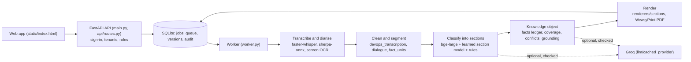

# Continuum KT Planner

Continuum turns a knowledge-transfer session into a handover document another
engineer can operate from. The input can be a recording, a Teams or Zoom
caption file, or a pasted transcript. The output is a 17-section KT document:

- a quick reference for incidents;
- the architecture, with a diagram of the connections that were actually
  stated;
- deployment and rollback, common failures and fixes, danger zones, and
  ownership and escalation;
- what was **not** covered, as a list to take back to the outgoing owner.

Every line of the document cites the sentence it came from.

It isn't a summariser. With no LLM at all it builds the whole document from
local models and rules. When an LLM (Groq) is configured, every answer it
gives is checked against the transcript and refused if it adds, drops or
reverses anything.

## What holds on every KT

1. **No fact lost.** Every statement classified from the transcript appears
   in the document. One a section left out is added under Additional Notes,
   and every fact has a ledger record
   (`knowledge_builder.verify_document_coverage`).
2. **Nothing invented.** LLM output is checked against the transcript or
   refused (`grounding.py`). Inferred values are marked as inferred.
3. **No meaning changed.** Rewrites keep every number, tool, negation, speaker
   and tense, and safety rules stay word for word.
4. **Gaps are honest.** A section is "covered" only when it was discussed.
   Undiscussed topics are named in a coverage matrix and a follow-up list.
5. **Every job finishes.** Each LLM request, each KT's LLM time and call
   count, and the local models are bounded. Any LLM failure falls back to the
   rules-only result.

## How well it works

Measured with the evaluation harness in `evaluation/`. The answer keys are
fixed in advance and are never edited to match output.

| Material | Facts placed in the right section |
|---|---|
| Written KTs the system was never tuned on (synthetic, written for testing; four held-back sets, one of them sealed), no LLM | 466 / 501 (93.0%) |
| The same, with Groq's section check | 482 / 501 (96.2%) |
| The visible KTs as unpunctuated speech-to-text | 1,057 / 1,085 (97.4%) |
| Recorded meetings (public DevOps meetings and mock KT sessions, Whisper `small`), ten worked on | 158 / 194 key facts (81.4%) |
| The same, five recordings held back | 105 / 132 key facts (79.5%) |

Two cautions:

- No customer's own KT has been measured yet.
- Recordings are the weakest input: misheard terms and personal asides reach
  the document. See Known limits.

## Architecture



Every stage is described in [docs/KT_PIPELINE.md](docs/KT_PIPELINE.md). How
corrections, changes and contradictions are handled is specified in
[docs/CORRECTIONS.md](docs/CORRECTIONS.md).

## Run it

Python 3.13. From the repository root:

```bash
python -m venv .venv && .venv/Scripts/activate        # or: source .venv/bin/activate
python -m pip install -r requirements.lock             # every version the tests ran with
python scripts/fetch_models.py                         # local models, once (never during a KT)
python -m auth create-tenant "Your team"               # prints a workspace id and its first admin key
uvicorn main:app                                       # the API, with one KT worker thread inside it
```

Open http://localhost:8000/ and sign in with the key.

- **LLM.** Put `GROQ_API_KEY` in `.env` to switch on the LLM checks. Without
  it every KT runs rules-only, and the document says so.
- **Separate workers, containers, single sign-on, Confluence and Jira,
  workspace limits, backups, metrics and alerts:** see
  [docs/OPERATIONS.md](docs/OPERATIONS.md).
  Example: `CONTINUUM_SECRET_KEY=... docker compose up --build`.

## Tests and evaluation

- **Tests:** about 1,050 test functions in `tests/`. Tests never call an LLM.
  The full suite takes hours on a laptop, so run the area you changed (the
  table in [CLAUDE.md](CLAUDE.md) lists them):

  ```bash
  python -m pytest -q tests/test_section_rules.py tests/test_coverage_topics.py
  ```

- **Accuracy:** `python evaluation/accuracy.py LABEL tuning,dev,holdout,blind2,blind3,e2e`
  ([evaluation/README.md](evaluation/README.md)).
- **Adversarial matrix:** `python evaluation/matrix.py LABEL`. Each of its
  short KTs targets one failure: corrections, hedges, contradictions,
  numbers, noise, conversation, PDF text. See
  [docs/ADVERSARIAL_MATRIX.md](docs/ADVERSARIAL_MATRIX.md).
- **Release gates:** `python evaluation/quality_gates.py LABEL --replay`, run
  on the PDFs ([docs/QUALITY_GATES.md](docs/QUALITY_GATES.md)).
- **Browser journey:** `evaluation/browser_journey.py`, about 20 minutes.
  It clicks through sign-in, building a KT, editing, exports, a server
  restart, a reader's view and phone width.
- **CI:** `.github/workflows/ci.yml` runs the tests from the lock file and
  builds the image.

## Repository map

| Path | What it is |
|---|---|
| `main.py`, `api/routes.py` | The web app and API |
| `auth.py`, `sso.py` | Workspaces, people, roles, API keys, OpenID Connect sign-in, audit log |
| `job_store.py`, `job_queue.py`, `worker.py` | Storage, the task queue (leases, retries, workspaces taking turns) and the workers |
| `quotas.py` | Each workspace's daily limits (KTs, recording minutes, LLM tokens) and its recorded use |
| `pipeline.py` | One KT end to end |
| `devops_transcription.py`, `punctuation.py`, `copyedit.py` | Cleaning speech into sentences |
| `dialogue.py`, `speaker_roles.py`, `fact_units.py` | Conversation: questions and answers, giver and receiver, disputes, one fact per unit |
| `context_mapper.py`, `section_rules.py`, `section_model.npz` | Placing each fact in its section |
| `knowledge/`, `coverage_topics.py`, `conflicts.py`, `grounding.py` | The knowledge object, coverage, contradictions, checks on LLM output |
| `field_populator.py`, `architecture_diagram.py` | Section fields; the architecture diagram |
| `renderers/`, `pdf_rendering.py`, `pdf/templates/` | The document and its PDF |
| `ask.py`, `signoff.py`, `sessions.py`, `document_model.py` | Ask the KT, sign-off, follow-up sessions, edits and versions |
| `llm/`, `llm_provider.py` | The optional LLM: cache, budgets, pacing |
| `evaluation/`, `tests/` | The evaluation harness and the tests |

## Known limits

- **Recordings.** About 80% of key facts are placed. Whisper `small`
  mishears some technical terms, and overlapping speech is not detected.
  Teams or Zoom caption files avoid most of this.
- **One fixed template.** The schema has 17 sections. Customer templates are
  not supported yet.
- **One host.** Storage is SQLite on one host, so the API and its workers must
  share a disk.
- **Administration from the command line.** Workspaces, people, keys, sign-in
  and integrations are managed with `python -m auth ...` (see the commands in
  `auth.py`).

For a security review: [SECURITY_AUDIT.md](SECURITY_AUDIT.md) (controls,
findings, dependency advisories) and
[docs/DATA_HANDLING.md](docs/DATA_HANDLING.md) (what is processed where, what
goes to the optional LLM, what is kept and for how long).

The full product and technical assessment, with what to fix in what order, is
[CONTINUUM_DUE_DILIGENCE_REPORT.md](CONTINUUM_DUE_DILIGENCE_REPORT.md). The
engineering record and issue ledger is [CLAUDE.md](CLAUDE.md), with the
evidence for every change in
[docs/REPOSITORY_AUDIT.md](docs/REPOSITORY_AUDIT.md).
